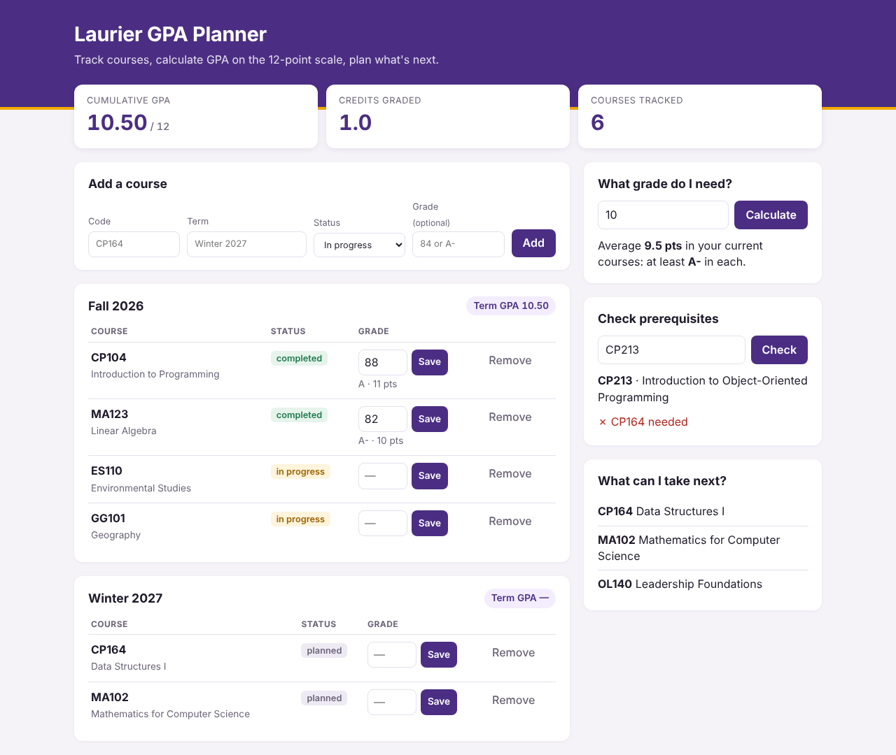

# Laurier Course & GPA Planner

A web app and command-line tool for Wilfrid Laurier University students to track courses, calculate GPA on Laurier's 12-point scale, and plan which courses they can take next based on prerequisites.



## Features

- **Course tracking** by term (completed, in progress, planned), saved automatically to a JSON file
- **GPA calculation** on Laurier's 12-point scale, credit-weighted, per term and cumulative
- **Accepts percentages or letter grades** (`84` or `A-`)
- **Target-GPA calculator**: tells you the minimum grade you need in your current courses to reach a goal GPA
- **Prerequisite checker**: shows what you've finished, what's in progress, and what's missing
- **"What can I take next?"**: lists every catalog course you're eligible for
- **Unit tests** with pytest

- **Web interface** built with Flask, with a layout that works on phones

## Run it

Requires Python 3.8+.

**Website version:**

```bash
pip install -r requirements.txt
python app.py
```

Then open http://127.0.0.1:5000 in your browser.

**Command-line version:**

```bash
python planner.py
```

Both versions share the same data file, so courses added in one show up in the other.

## Run the tests

```bash
pip install pytest
python -m pytest
```

## Project structure

| File | What it does |
|---|---|
| `app.py` | Website: Flask routes for pages and forms |
| `templates/index.html` | Website page layout (HTML + Jinja) |
| `static/style.css` | Website styling |
| `planner.py` | Command-line menu |
| `grades.py` | Grade conversion and GPA math |
| `prereqs.py` | Prerequisite and eligibility logic |
| `storage.py` | Loads/saves JSON files |
| `catalog.json` | Courses and their prerequisites |
| `test_planner.py` | Unit tests for the logic |
| `test_app.py` | Tests for the website |

## How GPA is calculated

Each grade converts to grade points (A+ = 12 … D- = 1, F = 0), using the scale from [Laurier's GPA calculator](https://students.wlu.ca/academics/support-and-advising/gpa-calculator/). GPA = sum of (points × credits) ÷ total graded credits.

## Adding courses to the catalog

Edit `catalog.json`. Each course needs a name, a credit weight, and a list of prerequisite course codes:

```json
"CP164": {"name": "Data Structures I", "credits": 0.5, "prereqs": ["CP104"]}
```

Check course names and prerequisites against the Laurier academic calendar.

## Ideas for future versions

- Deploy the website online (e.g. Render or PythonAnywhere)
- User accounts so several students can use it
- Import courses from a CSV file
- Support "one of" prerequisites (e.g. CP104 *or* CP114)
- Track degree requirements and credits remaining to graduate
